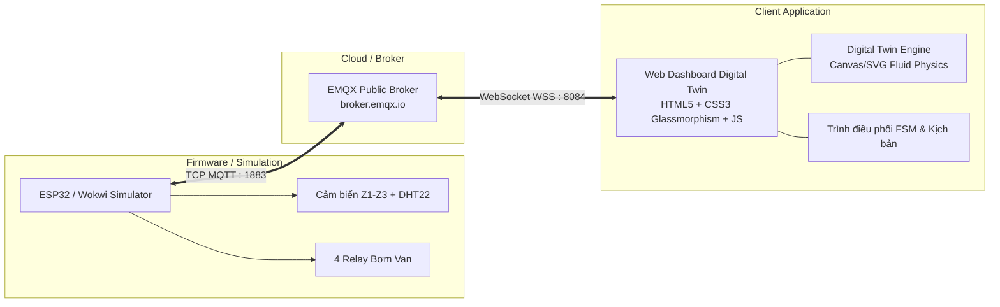
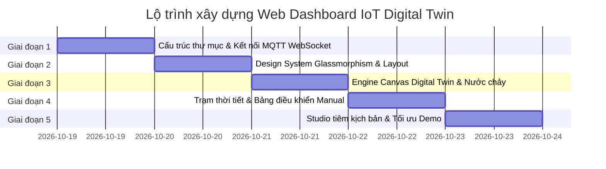

# 🌊 Kế hoạch & Lộ trình: Web Dashboard IoT Digital Twin (Smart Irrigation G11)

> **Mục tiêu:** Xây dựng một ứng dụng Web Dashboard chuẩn thương mại (Professional IoT Digital Twin), kết nối trực tiếp với ESP32/Wokwi thông qua giao thức **MQTT qua WebSocket**. Thay thế giao diện mặc định của Node-RED, mang lại trải nghiệm tương tác trực quan thời gian thực, phục vụ thuyết trình và báo cáo đồ án đạt điểm tối đa (Điểm A).

---

## 1. Kiến trúc hệ thống tổng thể



---

## 2. Các phân hệ tính năng cốt lõi (Core Modules)

### 2.1. Phân hệ 1: Bản sao số địa hình dốc (Digital Twin Terrain & Fluid Flow)
* **Mặt cắt địa hình 3 tầng:**
  - **Zone 1 (Đỉnh đồi):** Địa hình cao, độ dốc lớn, thoát nước nhanh.
  - **Zone 2 (Sườn giữa):** Vùng dốc thoải chuyển tiếp.
  - **Zone 3 (Thung lũng trũng):** Vùng đất thấp chân đồi, dễ bị tích nước chảy tràn gây ngập úng.
* **Mô phỏng dòng nước vật lý (Fluid Animation):**
  - **Hệ thống hạt nước (Water Particles):** Khi rơ-le bơm vùng nào kích hoạt, vòi phun tại vùng đó xuất hiện các tia nước hoạt họa sinh động.
  - **Hiệu ứng ngấm ẩm đất:** Đất đổi màu chân thực từ nâu sáng/nứt nẻ (khô cằn $<40\%$) sang nâu đen sẫm (đủ ẩm $60\%$) và phản chiếu ánh nước bóng mờ khi ngập úng ($\ge 80\%$).
  - **Hiệu ứng chảy tràn địa hình:** Trong chu kỳ nghỉ ngấm đất **`S9_SOAK_WAIT`**, xuất hiện các giọt nước rỉ dần từ Zone 1 chảy tràn xuống Zone 2 và đọng thành vũng nước dâng lên ở thung lũng Zone 3.

### 2.2. Phân hệ 2: Trạm thời tiết & Vi khí hậu (Weather & Climate Radar)
* **Vi khí hậu thực tế tại vườn (DHT22):** Đồng hồ đo Nhiệt độ (°C), Độ ẩm không khí (%), và Chỉ số cảm nhận nhiệt (Heat Index).
* **Dự báo khí tượng Open-Meteo:**
  - Hiển thị thanh tiến trình xác suất mưa $P_{max}$ (%).
  - Lượng mưa dự kiến $P_{eff}$ (mm).
  - Hoạt họa thời tiết tương ứng: Trời nắng rực rỡ, Mây mù mưa phùn nhẹ, hoặc Bão tố sấm chớp khi $P_{max} \ge 70\%$ & mưa lớn $\ge 10mm/h$.

### 2.3. Phân hệ 3: Bảng giám sát máy trạng thái FSM (State Visualizer)
* **Hiển thị trực quan trạng thái hệ thống:**
  - `S1_MONITOR`: Xanh lục (Ổn định).
  - `S3_RAIN_DELAY`: Xanh dương phát sáng (Hoãn tưới thông minh đón mưa).
  - `S4_IRRIGATING`: Vàng cam nhấp nháy xung tưới.
  - `S5_DRAIN` / `FLOOD_WARNING`: Đỏ cảnh báo ngập úng Zone 3.
  - `S6_MANUAL`: Tím công nghệ (Điều khiển thủ công).
  - `S8_FALLBACK`: Vàng chanh (Mất mạng, chạy tự trị).
  - `S9_SOAK_WAIT`: Xanh ngọc biển (Đang nghỉ ngấm đất).
  - `S99_SAFE`: Đỏ đậm viền Neon (Ngắt an toàn khẩn cấp).

### 2.4. Phân hệ 4: Studio điều khiển & Tiêm kịch bản (Demo & Testing Studio)
* **Chuyển chế độ AUTO / MANUAL:**
  - Công tắc chuyển đổi mượt mà với cảm giác gạt vật lý.
  - Nút bật/tắt độc lập 3 van bơm khi ở chế độ MANUAL.
  - Bộ đếm thời gian an toàn TTL đếm ngược 10 phút.
* **Cụm nút tiêm kịch bản nhanh (One-click Demo Presets):**
  - 🔘 **Preset 1 (Nắng ráo):** Gửi JSON nắng ráo $\rightarrow$ Kích hoạt chu trình tưới tuần tự Z1 $\rightarrow$ Z2 $\rightarrow$ Z3.
  - 🔘 **Preset 2 (Mưa phùn):** Gửi $P_{max}=75\%$, $P_{eff}=2mm$ $\rightarrow$ Xem hệ thống bỏ qua hoãn mưa, vẫn tưới bình thường.
  - 🔘 **Preset 3 (Mưa dông lớn):** Gửi $P_{max}=85\%$, $P_{eff}=15mm$ $\rightarrow$ Xem hệ thống lập tức ngắt bơm hoãn tưới tiết kiệm nước.
  - 🔘 **Preset 4 (Tiêm lỗi D1/D2):** Bắn mã lỗi đứt dây cảm biến hoặc kẹt van bơm $\rightarrow$ Kích hoạt trạng thái bảo vệ an toàn `S99_SAFE`.
  - 🔘 **Preset 5 (Khôi phục):** Nút Reset đưa hệ thống về trạng thái bình thường.

---

## 3. Lộ trình triển khai chi tiết từng giai đoạn



### Giai đoạn 1: Thiết lập nền móng & Kết nối MQTT WebSocket
- [ ] Khởi tạo cấu trúc thư mục module `dashboard/`.
- [ ] Tích hợp thư viện `mqtt.js` qua CDN để kết nối trực tiếp `wss://broker.emqx.io:8084/mqtt`.
- [ ] Hiện thực luồng subscribe các topic:
  - `g11/irrig/+/soil` (độ ẩm 3 vùng)
  - `g11/irrig/env` (nhiệt độ, độ ẩm DHT22)
  - `g11/irrig/status` & `state` (trạng thái hệ thống S0-S99)
  - `g11/irrig/weather` (dữ liệu dự báo thời tiết)
  - `g11/irrig/alert` (cảnh báo sự cố)
- [ ] Hiện thực luồng publish các topic điều khiển:
  - `g11/irrig/cmd/mode` (AUTO / MANUAL)
  - `g11/irrig/cmd/manual` (Bật/tắt bơm)
  - `g11/irrig/sim/weather` (Tiêm kịch bản thời tiết)
  - `g11/irrig/sim/fault` (Tiêm lỗi phần cứng)

### Giai đoạn 2: Thiết kế Design System & Giao diện Dashboard (Glassmorphism)
- [ ] Xây dựng bảng màu cao cấp (Deep Slate Dark Theme, HSL tailored accents).
- [ ] Tạo hiệu ứng kính mờ (Backdrop-filter blur, viền phát sáng gradient).
- [ ] Bộ thẻ chỉ số (KPI Cards):
  - 3 Gauge Card đo độ ẩm Z1, Z2, Z3 với thanh tiến trình tròn SVG mượt mà.
  - Card thời tiết vi khí hậu với biểu tượng thời tiết động.
  - Card máy trạng thái hệ thống với hiệu ứng phát sáng Neon.

### Giai đoạn 3: Phát triển Engine mô phỏng Digital Twin & Dòng nước (Canvas/SVG)
- [ ] Vẽ mô hình địa hình dốc tương tác:
  - Khối địa chất 3 tầng (Slope Terrain Cross-section).
  - Đường ống dẫn nước và vòi phun nhỏ giọt tại từng tầng.
- [ ] Lập trình hiệu ứng vật lý dòng chảy:
  - Tạo luồng hạt nước phun khi relay bật.
  - Chuyển sắc thái màu đất theo độ ẩm thực tế nhận từ cảm biến Wokwi.
  - Hoạt họa nước tràn từ sườn dốc xuống đọng vũng tại thung lũng Zone 3.

### Giai đoạn 4: Trạm thời tiết & Bảng điều khiển tương tác
- [ ] Hoàn thiện widget trạm khí tượng: Radar xác suất mưa $P_{max}$, tổng lượng mưa $P_{eff}$.
- [ ] Xây dựng bảng điều khiển thủ công:
  - Toggle Switch chế độ AUTO / MANUAL.
  - Nút bấm cơ học điều khiển van từng vùng (có hiệu ứng nhấn 3D và đèn báo trạng thái van thực tế).
  - Đồng hồ đếm ngược bảo vệ quá tải bơm (Timeout Watchdog).

### Giai đoạn 5: Testing Studio tiêm kịch bản & Tinh chỉnh Demo
- [ ] Tích hợp thanh công cụ Demo Presets (Bắn kịch bản mưa nắng và tiêm lỗi chỉ với 1 click).
- [ ] Thêm hiệu ứng âm thanh xúc giác (nhẹ nhàng khi bấm nút, âm báo khẩn cấp khi ngập úng Z3).
- [ ] Kiểm thử đồng bộ 2 màn hình: Vặn biến trở Wokwi $\leftrightarrow$ Web Dashboard cập nhật tức thì trong 0.1 giây.
- [ ] Đóng gói tài liệu hướng dẫn thuyết trình 5 phút cho buổi báo cáo đồ án.

---

## 4. Cấu trúc mã nguồn đề xuất

```text
SmartIrrigation/
├── dashboard/                     # Thư mục Web Dashboard độc lập
│   ├── index.html                 # Trang giao diện chính (HTML5 Semantic)
│   ├── css/
│   │   ├── style.css              # Design System, Glassmorphism, Layout
│   │   └── animations.css         # Hiệu ứng nước chảy, giọt mưa, neon glow
│   └── js/
│       ├── config.js              # Cấu hình Broker MQTT, Topics, Ngưỡng
│       ├── mqtt_client.js         # Quản lý WebSocket MQTT 2 chiều
│       ├── digital_twin.js        # Engine mô phỏng địa hình & nước chảy
│       └── app.js                 # Điều phối giao diện & Demo Presets
│
├── platformio.ini
├── diagram.json                   # Wokwi simulation
└── src/
    └── main.cpp                   # Firmware ESP32 FreeRTOS
```

---

## 5. Kịch bản trình diễn (Demo Flow) cho buổi báo cáo

| Bước | Hành động trên Web Dashboard | Hiện tượng trên Wokwi & Giao diện | Giá trị thuyết trình kỹ thuật |
| :---: | :--- | :--- | :--- |
| **1** | Mở Web song song với Wokwi | Web tự kết nối EMQX WebSocket, nhận dữ liệu thời gian thực | Kiến trúc phân tán (Distributed IoT), không phụ thuộc localhost |
| **2** | Vặn biến trở POT1 trên Wokwi | Độ ẩm Z1 tụt $\rightarrow$ Vòi phun Z1 hoạt ảnh nước phun $\rightarrow$ Relay 1 Wokwi đóng | Tưới tự động dựa trên độ ẩm đất thực tế |
| **3** | Đợi Z1 đủ nước | Đèn van Z1 tắt $\rightarrow$ Web báo `S9_SOAK_WAIT` $\rightarrow$ Nước rỉ từ Z1 xuống Z2 | Giải quyết bài toán địa hình dốc (Soak-Wait runoff) |
| **4** | Bấm nút "Inject Mưa to (W1)" | Đất đang khô nhưng hệ thống tự ngắt bơm $\rightarrow$ Báo `S3_RAIN_DELAY` | Tiết kiệm nước thông minh dựa trên dự báo Open-Meteo |
| **5** | Vặn POT3 lên $>80\%$ | Còi báo đỏ `FLOOD_WARNING`, khóa chặt van Z3 | Chống úng ngập thung lũng hạ lưu |
| **6** | Bấm nút "Tiêm lỗi đứt dây (D1)" | Toàn bộ hệ thống khóa van an toàn $\rightarrow$ Báo `S99_SAFE` | Cơ chế phòng vệ an toàn chủ động (Fault Tolerance) |
