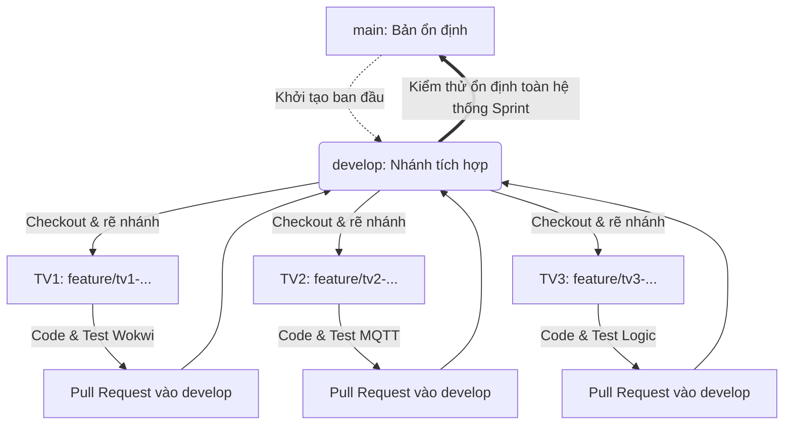

# 📘 SmartIrrigation_G11 - Sổ tay phát triển (Project Log)

> Dựa trên báo cáo chi tiết của nhóm và mẫu quy trình phát triển, tài liệu này chuẩn hóa chi tiết từng file, dòng code, quy tắc phối hợp và phân chia task cho 3 thành viên.  
> Được thiết kế đặc thù cho dự án **IoT (C++, PlatformIO, FreeRTOS, Wokwi)**, đảm bảo cả 3 người có thể lập trình song song mà **không bao giờ bị xung đột mã nguồn (Merge Conflict)**.

---

## 1. Tổng quan dự án

- **Tên dự án:** Hệ thống tưới tiêu thông minh dựa trên độ ẩm đất và dự báo thời tiết (Smart Irrigation G11).
- **Mô tả:** Hệ thống sử dụng ESP32 điều khiển 3 vùng tưới (Z1 cao, Z2 giữa, Z3 trũng) với logic tưới ngắt quãng, hoãn tưới khi có mưa (Open-Meteo), và cơ chế Fallback khi mất mạng.
- **Phương pháp tiếp cận:** *"Mô phỏng trước, phần cứng sau"* (Viết code 1 lần duy nhất, chuyển đổi linh hoạt giữa `MODE_SIM` và `MODE_HW` qua file cấu hình `include/config.h`).

---

## 2. Công nghệ & Thư viện (Tech Stack)

| Thành phần | Công nghệ / Công cụ sử dụng | Ghi chú |
| :--- | :--- | :--- |
| **Vi điều khiển** | ESP32 DevKit V4 | Dual-core Xtensa LX6, 240MHz, 320KB RAM |
| **Framework** | Arduino qua PlatformIO | Quản lý build, dependencies và toolchain |
| **Hệ điều hành nhúng** | FreeRTOS | Tách nhân: Core 0 (Mạng/MQTT) & Core 1 (Điều khiển/Sensors) |
| **Thư viện chính** | `PubSubClient` (v2.8.0)<br>`ArduinoJson` (v6.21.3)<br>`DHT sensor library` (v1.4.4) | Giao tiếp MQTT, phân tích chuỗi JSON, đọc cảm biến môi trường |
| **Mô phỏng** | Wokwi Simulator | Mô phỏng qua file `diagram.json` và `wokwi.toml` |
| **Dashboard** | Node-RED + Mosquitto MQTT Broker | Giám sát độ ẩm, trạng thái và điều khiển thủ công |
| **Quản lý mã nguồn** | Git & GitHub | Repo: `https://github.com/yanphan/iot-smart-irrigation.git`<br>Mô hình Git Flow: `main` (ổn định) + `develop` (tích hợp) |

---

## 3. Kiến trúc thư mục (Module-First)

> **Quy tắc vàng:** Tách biệt hoàn toàn Giao diện (`.h`) và Thực thi (`.cpp`), tách biệt logic Giả lập (`sim_*.cpp`) và Phần cứng thật (`hw_*.cpp`).

```text
SmartIrrigation_G11/
│
├── .gitignore                  # Bắt buộc: loại trừ .pio/, .vscode/, *.bin, *.elf
├── platformio.ini              # Cấu hình board esp32dev, lib_deps, build_flags
├── wokwi.toml                  # Cấu hình chạy giả lập Wokwi trong VS Code
├── diagram.json                # Sơ đồ đấu nối phần cứng mô phỏng trên Wokwi
│
├── include/                    # LỚP GIAO DIỆN (Chỉ chứa khai báo header)
│   ├── config.h                # Định nghĩa GPIO, Ngưỡng, chế độ CURRENT_MODE (SIM/HW)
│   ├── soil_sensor.h           # Abstract class / Interface cho SoilSensor
│   ├── weather.h               # Abstract class / Interface cho Weather
│   ├── pump_relay.h            # Abstract class / Interface cho PumpRelay
│   ├── decide.h                # Khai báo hàm thuần (Pure function) logic quyết định tưới
│   └── state_machine.h         # Khai báo enum State (S0 -> S9) và hàm chuyển trạng thái
│
└── src/                        # LỚP TRIỂN KHAI (Chứa mã nguồn thực thi)
    ├── main.cpp                # Khởi tạo FreeRTOS tasks (taskNetwork, taskControl), loop() để trống
    ├── sim_soil_sensor.cpp     # TV1: Đọc biến trở Wokwi (ADC 0-4095 -> 0-100%)
    ├── hw_soil_sensor.cpp      # TV1: Đọc ADC1 phần cứng thật, công thức hiệu chuẩn
    ├── sim_weather.cpp         # TV2: Nhận payload JSON giả lập từ MQTT topic sim/weather
    ├── hw_weather.cpp          # TV2: Gửi HTTP GET đến Open-Meteo API lấy dữ liệu thật
    ├── sim_pump_relay.cpp      # TV1: Xuất log Serial, điều khiển LED / Relay mô phỏng trên Wokwi
    ├── hw_pump_relay.cpp       # TV1: digitalWrite kích hoạt relay thật (Active LOW an toàn)
    ├── decide.cpp              # TV3: Hàm thuần toán học & logic, KHÔNG gọi Serial/digitalWrite
    └── state_machine.cpp       # TV3: Quản lý switch-case chuyển trạng thái S0 -> S9
```

---

## 4. Quy trình làm việc nhóm (Team Workflow)

### 4.1. Chiến lược phân nhánh (Branching Strategy)
- **Repository Remote:** `https://github.com/yanphan/iot-smart-irrigation.git`
- **Nhánh `main` (Production / Stable Release):**
  - Là nhánh chính, chỉ lưu trữ phiên bản code đã chạy ổn định và vượt qua kiểm thử trên Wokwi/phần cứng.
  - **Tuyệt đối KHÔNG code hay push trực tiếp vào `main`.** Chỉ merge từ `develop` khi kết thúc một Sprint hoặc chuẩn bị nộp bài/demo.
- **Nhánh `develop` (Main Integration Branch):**
  - Là nhánh tích hợp trung tâm của cả 3 thành viên.
  - Cả 3 thành viên rẽ nhánh từ `develop` để làm task, và tạo Pull Request (PR) để merge code vào `develop` sau khi hoàn thành.
- **Nhánh tính năng (`feature/ten-task` hoặc `bugfix/ten-loi`):**
  - Nhánh làm việc độc lập của từng cá nhân (VD: `feature/tv1-sim-sensor`, `feature/tv2-mqtt-client`, `feature/tv3-decide-logic`).

### 4.2. Quy tắc đặt tên Commit (Conventional Commits)
- `feat:` Thêm tính năng mới (VD: `feat: Hoàn thành hàm decide() cho vùng Z3`)
- `fix:` Sửa lỗi (VD: `fix: Sửa lỗi relay tự bật khi khởi động`)
- `refactor:` Tối ưu hóa code mà không thay đổi logic nghiệp vụ

### 4.3. Vòng lặp công việc hàng ngày (Daily Routine)


1. **Đồng bộ nhánh develop mới nhất:**
   ```bash
   git checkout develop
   git pull origin develop
   ```
2. **Tạo nhánh làm việc riêng cho task:**
   ```bash
   git checkout -b feature/ten-task-cua-ban
   ```
3. **Lập trình & Kiểm thử cục bộ:** Tuân thủ hằng số trong `include/config.h`, tuyệt đối không hardcode chân GPIO hay giá trị ngưỡng trong file `.cpp`.
4. **Đẩy code lên GitHub:**
   ```bash
   git add .
   git commit -m "feat: mô tả ngắn gọn công việc"
   git push -u origin feature/ten-task-cua-ban
   ```
5. **Tạo Pull Request:** Lên GitHub tạo Pull Request từ `feature/ten-task-cua-ban` vào nhánh `develop`. Sau khi nhóm review và xác nhận không lỗi mới merge. Khi toàn bộ Sprint hoàn tất và chạy ổn định mới merge `develop` vào `main`.

### 4.4. Quy tắc "Bất di bất dịch" trong Code IoT (Definition of Done)
- [ ] **An toàn Relay (Active LOW):** Khi khởi tạo relay trong `setup()`, bắt buộc phải gọi `digitalWrite(PIN_RELAY, HIGH)` (trạng thái tắt) **TRƯỚC KHI** gọi lệnh `pinMode(PIN_RELAY, OUTPUT)`.
- [ ] **Hàm thuần `decide()`:** Tuyệt đối **KHÔNG** chứa `Serial.print`, `digitalWrite`, hay `delay()`. Hàm chỉ nhận struct đầu vào (`State`) và trả về struct lệnh (`Command`).
- [ ] **Tuyệt đối không dùng ADC2 khi bật Wi-Fi:** Trên ESP32, bộ ADC2 bị xung đột với Wi-Fi. Tất cả cảm biến độ ẩm đất bắt buộc phải nối vào các chân thuộc ADC1 (`GPIO 36`, `GPIO 39`, `GPIO 34`).
- [ ] **Không commit file rác:** File `.gitignore` phải loại trừ triệt để `.pio/`, `.vscode/`, `.clangd`, `compile_commands.json`.

---

## 5. Phân chia Task chi tiết - SPRINT 1: Chế độ mô phỏng (SIM)

### 👨‍💻 Thành viên 1: Hardware & Simulation Master (TV1)
**Mục tiêu:** Xây dựng hệ thống mô phỏng Wokwi chạy ổn định, các lớp cảm biến và relay mô phỏng hoạt động chuẩn đặc tính vật lý (Active LOW, độ trễ ngấm nước).

| Task | Vị trí file | Tên file | Outcome chi tiết |
| :--- | :--- | :--- | :--- |
| **1. Cấu hình Wokwi** | Gốc dự án | `diagram.json`<br>`wokwi.toml` | Sơ đồ gồm ESP32, DHT22, 4 Relay, 3 Biến trở (giả lập Z1, Z2, Z3). Nối dây chính xác vào GPIO 36, 39, 34, 27, 26, 25, 33. |
| **2. Cấu hình dùng chung** | `include/` | `config.h` | Định nghĩa `MODE_SIM 1`, `MODE_HW 2`, `CURRENT_MODE`. Khai báo các ngưỡng độ ẩm (khô, đủ, ngập) cho Z1, Z2, Z3 và toàn bộ `#define PIN_...` |
| **3. Lớp Cảm biến (SIM)** | `include/`<br>`src/` | `soil_sensor.h`<br>`sim_soil_sensor.cpp` | Hiện thực `readMoisturePercent(zone)`: Đọc `analogRead()` từ biến trở Wokwi, ánh xạ từ dải (0-4095) sang dải phần trăm (0-100%). |
| **4. Lớp Relay (SIM)** | `include/`<br>`src/` | `pump_relay.h`<br>`sim_pump_relay.cpp` | Hiện thực `turnOn(zone)`, `turnOff(zone)`. Ghi mức HIGH trước khi `pinMode`. Đếm thời gian `pump_duration` để chống quá tải/cháy bơm. |

---

### 👨‍💻 Thành viên 2: Network & Cloud Master (TV2)
**Mục tiêu:** ESP32 kết nối Wi-Fi và MQTT ổn định, phân tích cú pháp JSON thời tiết chính xác, sẵn sàng kích hoạt chế độ Fallback khi mất mạng.

| Task | Vị trí file | Tên file | Outcome chi tiết |
| :--- | :--- | :--- | :--- |
| **1. MQTT Client** | `include/`<br>`src/` | `mqtt_client.h`<br>`mqtt_client.cpp` | Kết nối MQTT Broker, thiết lập Last Will (`g11/irrig/status` = offline), subscribe `g11/irrig/cmd/#`, publish `g11/irrig/z1/soil`, `state`. |
| **2. Lớp Thời tiết (SIM)** | `include/`<br>`src/` | `weather.h`<br>`sim_weather.cpp` | Lắng nghe chuỗi JSON thời tiết giả lập từ topic `g11/irrig/sim/weather` (do Node-RED bắn vào), dùng `ArduinoJson` parse ra lượng mưa `P_max`, `P_eff`. |
| **3. Lớp Thời tiết (HW)** | `include/`<br>`src/` | `hw_weather.cpp` | Viết hàm `HTTPClient` gửi request GET tới Open-Meteo API. Cấu hình timeout 10s. Nếu thất bại liên tiếp 3 lần -> bật cờ `API_ERROR` kích hoạt chế độ Fallback. |
| **4. Dashboard Node-RED** | Thư mục ngoài | `flow_node-red.json` | Tạo 3 đồng hồ đo (Gauge) độ ẩm Z1-Z3, 1 Text hiển thị State (S0-S9), 1 Switch điều khiển MANUAL, 1 nút "Inject W1" để gửi JSON thời tiết mưa giả lập. |

---

### 👨‍💻 Thành viên 3: Core Logic & State Machine Master (TV3)
**Mục tiêu:** Xây dựng "Bộ não" của hệ thống. Hàm `decide()` vượt qua 100% test case (A, B, C, D) theo báo cáo, tích hợp điều phối tác vụ FreeRTOS hai nhân mượt mà.

| Task | Vị trí file | Tên file | Outcome chi tiết |
| :--- | :--- | :--- | :--- |
| **1. Hàm thuần Logic** | `include/`<br>`src/` | `decide.h`<br>`decide.cpp` | Viết hàm `Command decide(State s)`. Áp dụng đúng bảng quyết định §4.8: Tính `P_eff`, so sánh độ khô `D_khô`, xử lý logic ưu tiên hoãn/xả cho vùng trũng Z3 khi mưa lớn. |
| **2. Máy trạng thái** | `include/`<br>`src/` | `state_machine.h`<br>`state_machine.cpp` | Hiện thực switch-case chuyển trạng thái S0 -> S1 -> S2 -> (S3 hoặc S8) -> S4 -> S9. Quản lý timer tưới ngắt quãng `delay_timer` và thời gian ngấm đất `soak_wait_timer`. |
| **3. Điều phối FreeRTOS** | `src/` | `main.cpp` | Tạo `taskNetwork` (Core 0): gọi `mqtt.loop()`, cập nhật `weather`. Tạo `taskControl` (Core 1): đọc cảm biến định kỳ -> gọi `decide()` -> điều khiển relay. |
| **4. Bộ Test Case (PC)** | `src/` (tạm thời) | `test_decide.cpp` | Viết các hàm unit test `test_B1()`, `test_C1()` truyền dữ liệu giả lập vào `decide()` và dùng `assert()` kiểm tra tính đúng đắn như mục §5.6 trong báo cáo. |

---

## 6. Phân chia Task chi tiết - SPRINT 2: Tích hợp phần cứng thật & Hoàn thiện

*Sau khi Sprint 1 chạy mượt trên Wokwi và Node-RED, toàn đội chuyển sang giai đoạn đấu nối phần cứng thật.*

### 👨‍💻 Thành viên 1: Hiệu chuẩn & Đấu nối phần cứng
- Đổi cấu hình sang phần cứng thật trong `include/config.h`: `#define CURRENT_MODE MODE_HW`.
- **Hiệu chuẩn cảm biến độ ẩm đất điện dung:** Đo giá trị ADC khi đất khô kiệt, đất đủ ẩm bình thường và đất ngập nước bão hòa. Cập nhật các mốc vào công thức hàm `map()` trong `hw_soil_sensor.cpp`.
- **Lắp ráp & An toàn điện:** Module Relay phải dùng nguồn riêng (5V/12V), có diode flyback chống xung ngược, đấu nối đúng các chân GPIO 27, 26, 25, 33 (tránh tuyệt đối chân strapping 0, 2, 12, 15).

### 👨‍💻 Thành viên 2: Kết nối API thật & Kịch bản Fallback
- Kích hoạt lớp thời tiết thật trong `hw_weather.cpp` (kết nối HTTP GET đến Open-Meteo).
- **Kiểm thử kịch bản D3, D4:** Ngắt kết nối Wi-Fi hoặc chặn router, kiểm tra xem hệ thống có tự chuyển sang chế độ `FALLBACK` (tưới độc lập dựa trên độ ẩm đất, bỏ qua thời tiết) và tự phục hồi khi có mạng trở lại hay không.
- **Hoàn thiện Node-RED Dashboard:** Bổ sung biểu đồ lịch sử tưới theo thời gian thực, bảng cảnh báo nguy cơ úng ngập `FLOOD_RISK` hoặc lỗi kẹt bơm `PUMP_TIMEOUT`.

### 👨‍💻 Thành viên 3: Tinh chỉnh Logic ngấm nước & Thực nghiệm Demo
- **Thực nghiệm khay đất dốc:** Đo thời gian nước ngấm thực tế (`SOAK_WAIT`) trên mô hình và hiệu chỉnh hằng số `SOAK_WAIT_TIME` trong `include/config.h` (khoảng 120s – 180s).
- Chạy toàn bộ bộ kịch bản Test Case A, B, C, D trên mô hình thật và ghi nhận số liệu vào báo cáo.
- **Quay video demo 10 phút:** Thực hiện đúng kịch bản nghiệm thu §5.8 (Bật dashboard -> Tưới Z1 -> Tiêm kịch bản mưa W1 -> Rút Wi-Fi kiểm tra Fallback -> Thử nghiệm chế độ MANUAL).

---

## 7. Sổ tay xử lý sự cố thường gặp (Troubleshooting)

| Triệu chứng lỗi | Nguyên nhân tiềm ẩn | Giải pháp khắc phục (Người phụ trách) |
| :--- | :--- | :--- |
| **Wokwi báo lỗi "WiFi disconnected"** | Wokwi-GUEST bị quá tải hoặc cổng 1883 bị chặn. | Chuyển sang broker công cộng khác (như `broker.emqx.io` port 1883) hoặc dùng `WiFiClientSecure` với `setInsecure()`. *(TV2)* |
| **Relay nhảy tạch tạch liên tục khi cắm nguồn** | Dùng nhầm chân strapping (0, 2, 12, 15) hoặc chưa gán mức HIGH trước khi bật `OUTPUT`. | Sử dụng đúng các chân an toàn GPIO 27, 26, 25, 33. Kiểm tra lại hàm khởi tạo trong `pump_relay.cpp`. *(TV1)* |
| **Độ ẩm đất đo về nhảy số loạn xạ** | Nhiễu tín hiệu ADC từ nguồn hoặc chưa hiệu chuẩn. | Thêm bộ lọc trung bình động (moving average filter) từ 5 – 10 mẫu trong `hw_soil_sensor.cpp`. *(TV1)* |
| **Xung đột mã nguồn (Merge Conflict) ở `config.h`** | 2 thành viên cùng sửa đổi thông số ngưỡng hoặc thêm `#define`. | **Tuyệt đối không tự ý xóa code của bạn.** Mở VS Code chọn "Accept Both Changes", sau đó trao đổi nhanh 5 phút để thống nhất giá trị chung. *(Cả nhóm)* |
| **ESP32 tự khởi động lại liên tục (Guru Meditation Error)** | Tràn bộ nhớ ngăn xếp (Stack Overflow) trong FreeRTOS task hoặc truy cập con trỏ NULL. | Tăng `stack_size` trong `xTaskCreatePinnedToCore` (tăng từ 4096 lên 8192 bytes). Kiểm tra kỹ con trỏ trong `decide.cpp`. *(TV3)* |
| **Cảnh báo editor: Unknown argument '-mlongcalls'** | Trình kiểm tra cú pháp `clangd` không khớp cú pháp cờ của GCC Xtensa. | Đã cấu hình xử lý bằng file `.clangd` ở thư mục gốc để lọc bỏ cờ này. *(Hệ thống)* |

---

## 8. Checklist nghiệm thu trước khi nộp đồ án & Demo

- [ ] Toàn bộ mã nguồn đã được định dạng chuẩn (nhấn <kbd>Shift</kbd> + <kbd>Alt</kbd> + <kbd>F</kbd> trong VS Code).
- [ ] File `.gitignore` đã loại trừ toàn bộ thư mục `.pio/`, `.vscode/`, `.clangd`.
- [ ] Chạy mô phỏng trên Wokwi (`diagram.json`) không còn bất kỳ dòng log cảnh báo đỏ nào.
- [ ] Dashboard Node-RED hiển thị đầy đủ thông số 3 vùng tưới và đúng trạng thái máy trạng thái (S0 - S9).
- [ ] Hàm `decide()` đã vượt qua toàn bộ các test case độc lập trên PC.
- [ ] Báo cáo đồ án đã điền đầy đủ dữ liệu thực nghiệm vào các bảng Test Case A, B, C, D.

> 💡 **Lời khuyên cho Nhóm 11:** Sức mạnh cốt lõi của đồ án này nằm ở **kiến trúc tách lớp (SIM/HW)** và **hàm thuần `decide()`**. Nhờ kiến trúc này, **TV3** có thể viết và kiểm thử logic trên máy tính mà không cần chờ phần cứng, **TV2** có thể hoàn thiện dashboard Node-RED độc lập, và **TV1** có thể tùy chỉnh cảm biến/mạch mà không làm ảnh hưởng đến code của hai bạn còn lại. Chúc Nhóm 11 đạt kết quả xuất sắc!
